# AVABerzerk

A recreation of Stern's 1980 arcade game **Berzerk**, built with .NET 10 and Avalonia UI. You are the
humanoid intruder, trapped in an endless maze of rooms with electrified walls and full of robots that
want you dead, and that tell you so: *"Intruder alert! Intruder alert!"* Shoot your way through each
room, or just get out of it, before Evil Otto comes bouncing in after you.

## Features

- **The maze**: endless rooms laid out the cabinet's way, eight pillars with a wall running off each one.
  A room's layout comes from its place in the maze, so it's the same every time you pass through it. The
  door you came in by shuts behind you.
- **Electrified walls**: touch one and you fry.
- **Stand and shoot**: fire in eight directions, but you can't move while you're firing.
- **Robots** that change colour from room to room, as on the cabinet: dark yellow ones that don't
  shoot, then red, dark cyan, green, purple, yellow and white robots with more shots in the air and faster
  bolts, and round again quicker. They blow up on walls, on each other, and on each other's shots.
- **Evil Otto**: linger too long and he comes bouncing in through the door you used, straight through the
  walls. He can't be destroyed, and once the robots are all gone he's faster than you.
- **The talking robots**: *"Intruder alert!"*, *"The humanoid must not escape!"*, *"Chicken! Fight like a
  robot!"* if you run with robots still standing, and *"Got the humanoid!"* when they get you, all spoken
  in a flat, buzzing robot voice.
- **The room scrolls away** as you leave, and the next one scrolls in.
- **Keyboard, mouse or gamepad**: walk and aim with the stick or keys; with the mouse, the right button
  walks toward the pointer and the left fires at it.
- **Synthesised sound**: bolts, robots exploding, the electric crackle of a fried humanoid, and Otto's
  boing.
- **Attract mode**: leave the title screen alone for 20 seconds and a computer player plays a silent
  demonstration.
- **Top-ten high-score table** with arcade-style initials entry.
- **Any window size**: the 4:3 screen scales to fit, letterboxed. **Ctrl+S** saves a screenshot.
- **One self-contained executable** per platform: Windows, macOS and Linux on Intel/AMD and ARM.

## Screenshots

| Title screen | A duel | Evil Otto |
|:------------:|:------:|:---------:|
| 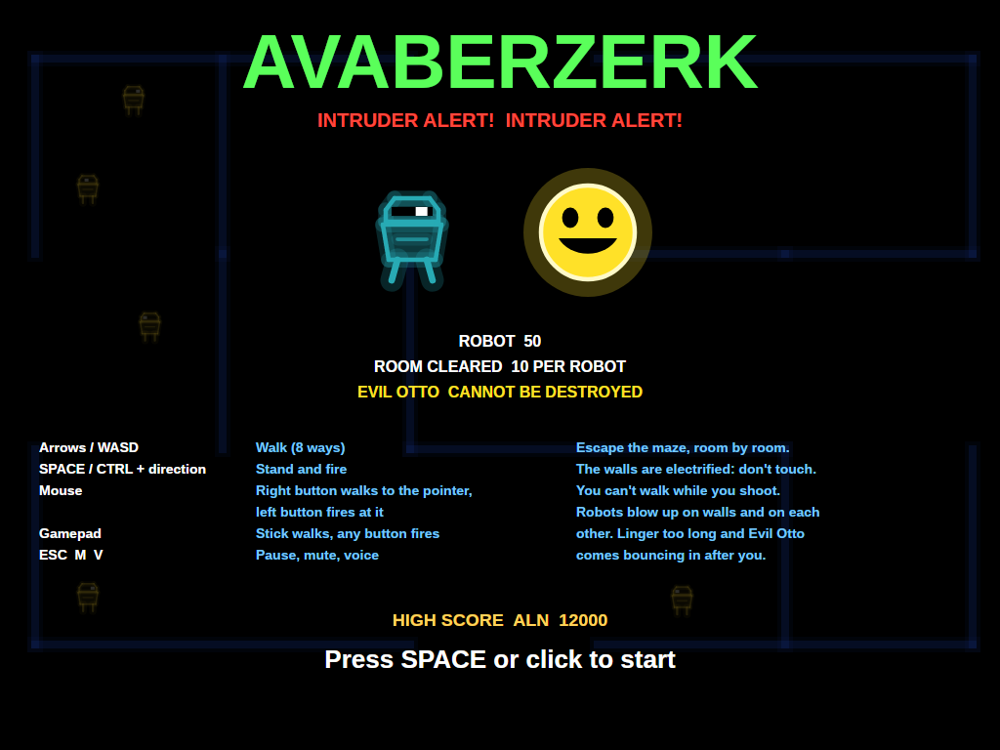 | 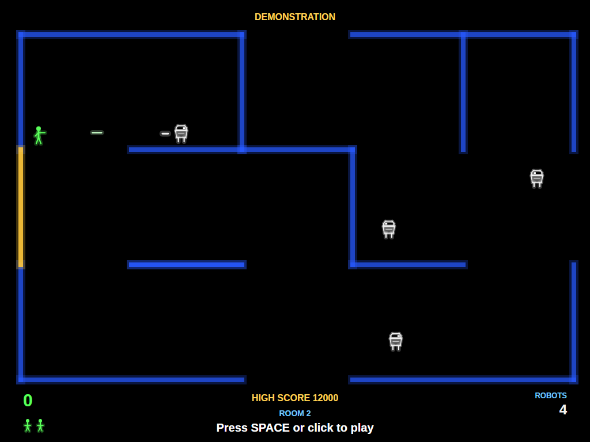 | 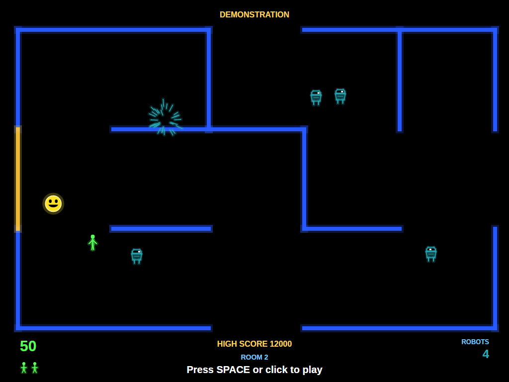 |
| A robot and Evil Otto, larger than life. | Standing still to fire, while a white robot fires back. | Otto comes through the wall from the door the humanoid used. |

| Robots | Another room | Fried |
|:------:|:------------:|:-----:|
| 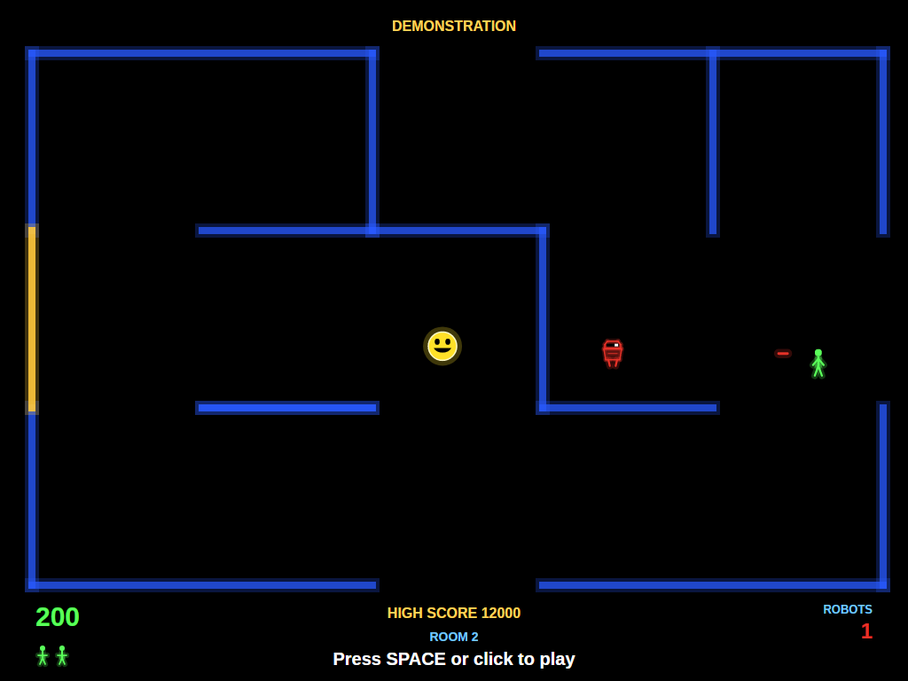 | 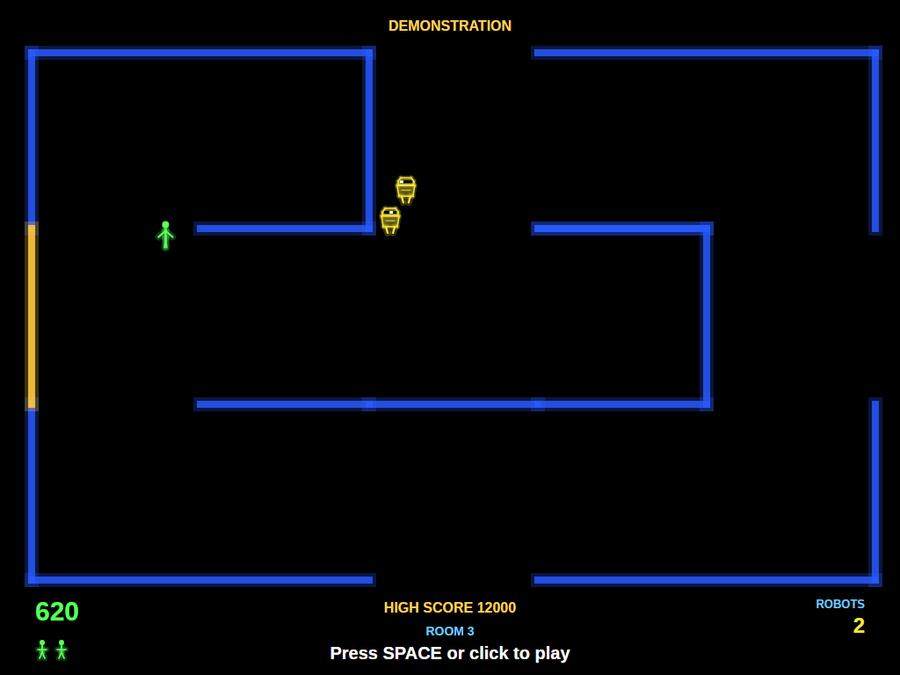 | 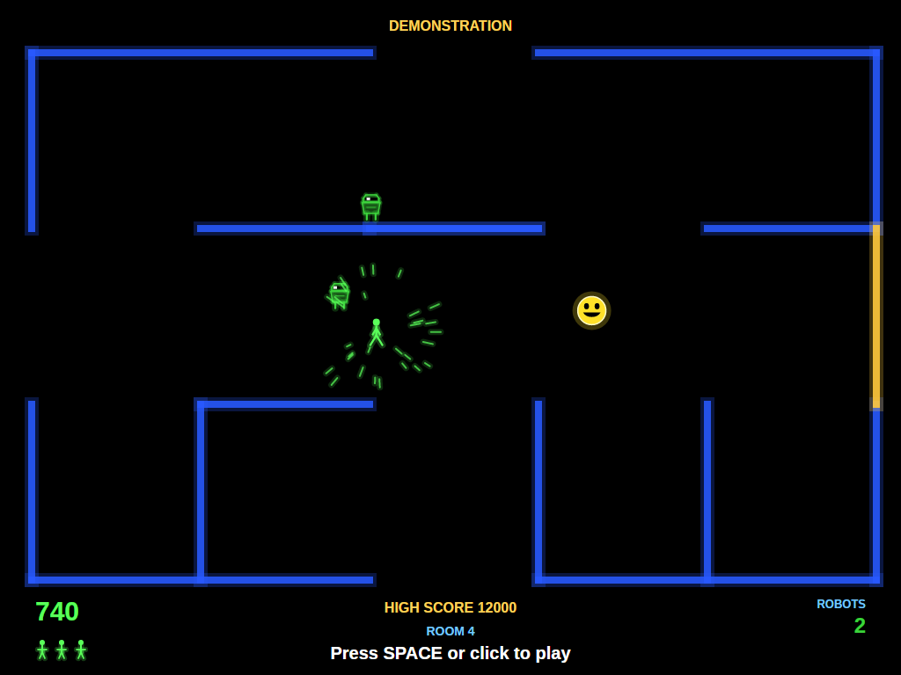 |
| One red robot left, and Otto on the way. | The colour of the robots changes from room to room. | Caught: the humanoid flashes and goes up. |

| Room cleared | On to the next room | Game over |
|:------------:|:-------------------:|:---------:|
| 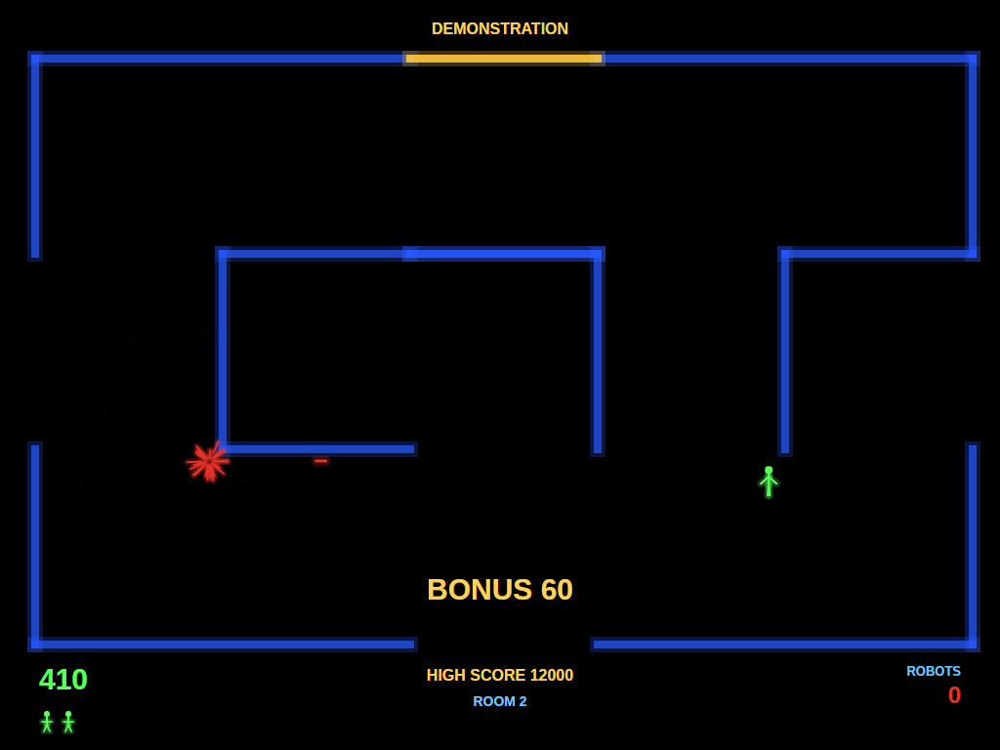 | 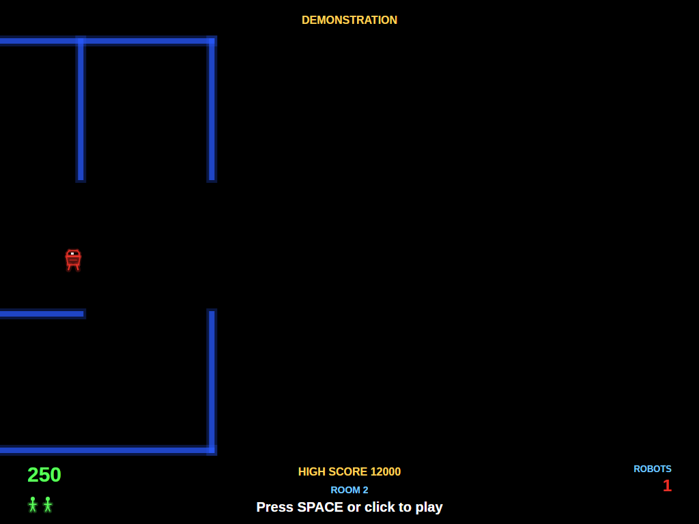 | 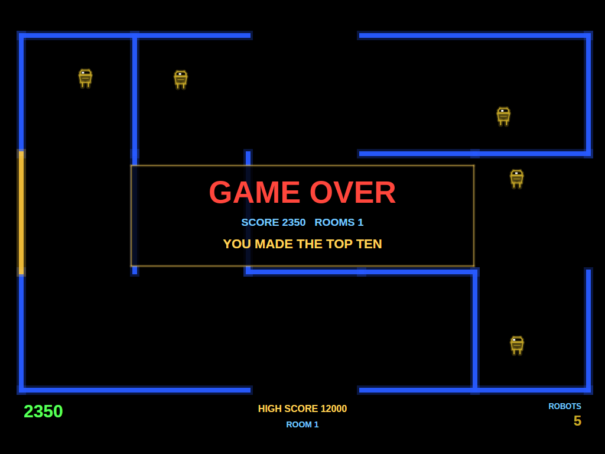 |
| Every robot gone: the bonus. | The old room scrolls out as the humanoid leaves. | No humanoids left. |

| Entering initials | The high-score table |
|:-----------------:|:--------------------:|
| 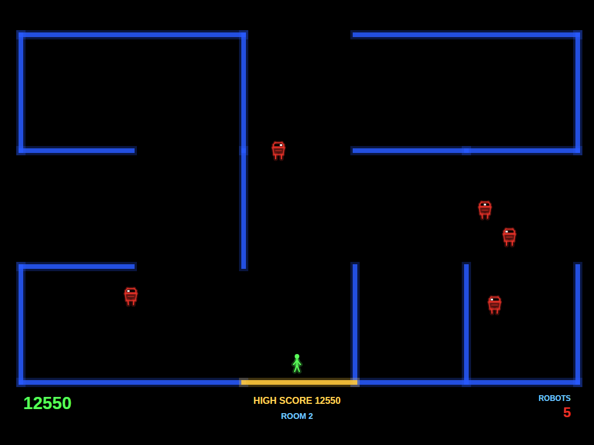 | 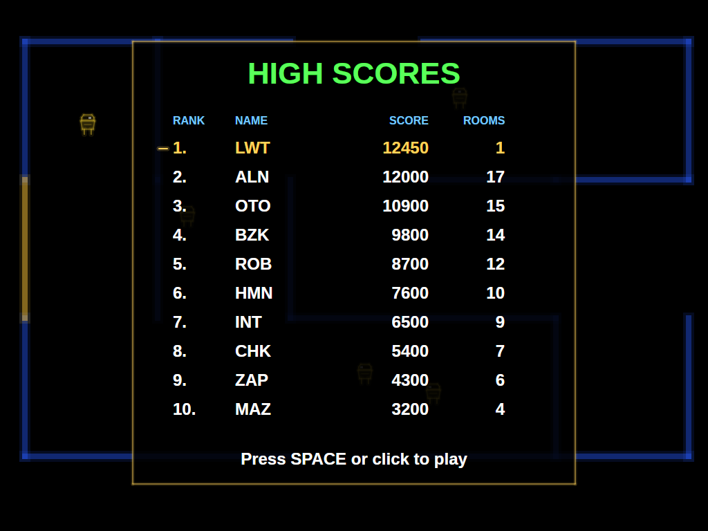 |
| A score that makes the top ten earns three initials. | The new entry flashes in the table. |

## Download and run

Ready-to-run builds for Windows, macOS and Linux, on both Intel/AMD and ARM, are on the
[Releases page](https://github.com/Harlock123/AVABerzerk/releases). **Latest build** is rebuilt on every
push to `main`. Each download is one self-contained executable: no .NET install is needed.

```bash
tar -xzf AVABerzerk-linux-arm64.tar.gz     # or linux-x64, linux-arm, osx-arm64, osx-x64
./AVABerzerk
```

On Windows, unzip `AVABerzerk-win-x64.zip` (or `-win-arm64`, `-win-x86`) and run `AVABerzerk.exe`. On
macOS, if Gatekeeper refuses to open it, run `xattr -d com.apple.quarantine AVABerzerk` once.

### Linux: sound and gamepads

- **Sound** needs `aplay`, from the `alsa-utils` package. Without it the game runs but is
  silent. Minimal installs (Arch, Omarchy, some Raspberry Pi images) don't include it:

  ```bash
  sudo apt install alsa-utils             # Debian / Ubuntu / Raspberry Pi OS
  sudo pacman -S --needed alsa-utils      # Arch / Omarchy
  ```

- **Gamepads** use SDL2. It is bundled for Windows, macOS and Intel/AMD Linux, but **ARM Linux builds need it
  installed**. Without it the keyboard and mouse still work; only the controller does not:

  ```bash
  sudo apt install libsdl2-dev            # Debian / Ubuntu / Raspberry Pi OS
  sudo pacman -S --needed sdl2-compat     # Arch / Omarchy
  ```

  On Debian-based systems it has to be `libsdl2-dev`: the game looks for `libSDL2.so`, which
  the runtime-only `libsdl2-2.0-0` package doesn't provide.

## Requirements

- .NET 10 SDK (to build; the released executables need nothing)
- Windows, macOS or Linux

## Building and Running

```bash
cd AVABERZERK
dotnet build
dotnet run
```

## Controls

The cabinet had one eight-way joystick and one fire button. Holding fire and pushing the stick shoots
that way; you stand still while you do.

### Keyboard

| Key | Action |
|-----|--------|
| **Arrows** / **W A S D** | Walk (eight directions) |
| **Space** / **Ctrl** + a direction | Stand and fire that way (or the way you're facing) |
| **Esc** | Pause (Esc again to quit) |
| **M** | Mute all sound |
| **V** | The robots' voices on/off |

### Mouse

| Input | Action |
|-------|--------|
| **Right Button** (held) | Walk toward the pointer |
| **Left Button** (held) | Stand and fire toward the pointer |

### Controller (Xbox/PlayStation/Switch Pro)

| Input | Action |
|-------|--------|
| **Left Stick** / **D-Pad** | Walk, or aim while firing |
| **A**, **B**, **X**, **bumpers**, **triggers** | Fire |
| **Start** | Pause / Resume game |
| **Back/Select** (while paused) | Exit game |

### Entering initials

| Key | Action |
|-----|--------|
| **A**–**Z**, **0**–**9**, **.** | Type a letter and move to the next |
| **Up** / **Down** | Dial the current letter |
| **Left** / **Backspace**, **Right** | Move between letters |
| **Space** | Accept the letter |
| **Enter** | Done |

Gamepad: D-pad dials and moves, **X** accepts, **Start** finishes. Mouse: the wheel dials, a click accepts.

### Other

| Key | Action |
|-----|--------|
| **Ctrl+S** / **Cmd+S** | Save screenshot to Pictures folder |

## Gameplay

### Rooms

Each room has a doorway in the middle of each side. The one you came in by is barred behind you; walk out
through any of the others to move on to the next room in that direction. Kill every robot in a room
first and you get a bonus of 10 points per robot; leave with robots still standing and they call you a
chicken.

You may have two shots in the air at a time. Walls are electrified: touching one kills you, and so does
touching a robot, a robot's shot, or Evil Otto. When you lose a life, play carries on in a fresh room.

### Robots

Robots lumber toward you and fire along any of the eight lines that runs to you through open space. They
are not clever: they walk into walls and into each other, and their own shots kill each other, and every
robot destroyed, however it happens, is worth 50 points to you.

| Room | Robots | Shots in the air |
|------|--------|------------------|
| 1 | Dark yellow | None: they don't shoot |
| 2 | Red | 1 |
| 3 | Dark cyan | 2 |
| 4 | Green | 3 |
| 5 | Purple | 4 |
| 6 | Yellow | 5 |
| 7 | White | 1, very fast |
| 8 | Light cyan | 3, fast |
| 9 | Pink | 4, fast |

After the ninth room the cycle starts again, each time a little faster.

### Evil Otto

After a while in a room (longer when it holds more robots), Evil Otto comes bouncing in from the door you
came through. He moves straight through walls and robots, and can't be shot. While robots remain he's a
little slower than you; once they're all gone, he's faster. Don't hang about.

### Lives

You start with three lives, and earn another at 5,000 points and every 10,000 after that.

## Scoring

| Event | Points |
|-------|--------|
| Robot destroyed (by you, a wall, another robot or a robot's shot) | 50 |
| Every robot in a room destroyed | 10 per robot |
| Extra life | at 5,000, 15,000, 25,000... |

## Sound Effects

All effects are synthesised by `tools/make_sounds.py`; nothing is sampled from the original machine. The
robots' words are made by `tools/make_voice.sh` with the [Piper](https://github.com/rhasspy/piper)
text-to-speech engine and turned into a flat, buzzing robot voice by `tools/robot_voice.py`.

| Sound | When |
|-------|------|
| `Shot.wav` / `RobotShot.wav` | Your gun / a robot's |
| `RobotBoom.wav` | A robot destroyed |
| `Zap.wav` | The humanoid electrocuted or shot |
| `WallHit.wav` | Your shot striking a wall |
| `Exit.wav` | Leaving a room |
| `Bonus.wav` | A room cleared |
| `Otto.wav` / `OttoBounce.wav` | Evil Otto appears / bouncing (loops) |
| `ExtraLife.wav` | An extra life |
| `Voice*.wav` | *Intruder alert!*, *The humanoid must not escape!*, *Chicken! Fight like a robot!*, *Got the humanoid! Got the intruder!*, *Kill the humanoid!*, *Destroy the intruder!*, *Charge! Attack!*, *Shoot it! Shoot it!*, *Get the humanoid!*, *Coins detected in pocket!* |

## Project Structure

```
AVABERZERK/
├── AVABerzerk.csproj, AVABerzerk.slnx
├── Program.cs, App.axaml(.cs), MainWindow.axaml(.cs)
├── Engine/
│   ├── GameEngine.cs        # States, the humanoid, scoring and lives
│   ├── GameEngine.Room.cs   # Rooms, robots, bolts, Evil Otto, moving between rooms
│   ├── AttractPilot.cs      # The computer player for attract mode, with grid pathfinding
│   ├── HighScoreTable.cs, InitialsEntry.cs
│   ├── InputHandler.cs      # Eight-way stick and fire from keyboard, mouse and gamepad
│   ├── ControllerManager.cs # SDL2 gamepad support
│   └── SoundManager.cs      # Effects, Otto's bounce, the robots' voice queue
├── Models/
│   ├── Room.cs              # The maze room generator
│   ├── Entities.cs          # Humanoid, robots, bolts, Otto, and the robot colour table
│   └── Explosion.cs
├── Views/
│   ├── GameCanvas.cs        # Input, game loop, overlays
│   ├── GameCanvas.Room.cs   # Walls, robots, the humanoid, shots, Otto, the room scroll
│   ├── GameCanvas.Screens.cs# Score, lives, title, entry and table screens
│   └── GameCanvas.Draw.cs   # Glowing shapes, lines and text
├── Sounds/                  # Generated WAV files
├── Images/                  # README screenshots
└── tools/
    ├── make_sounds.py       # Synthesises the sound effects
    ├── make_voice.sh        # Speaks the robots' lines with Piper
    └── robot_voice.py       # Makes them a flat, buzzing robot voice
```

## Technical Details

- **Framework**: Avalonia UI 12.1 on .NET 10
- **Audio**: NetCoreAudio for cross-platform sound playback
- **Controller**: SDL2 GameController API for cross-platform gamepad support
- **Rooms**: an outer wall with four doorways and eight interior pillars, each with a wall in one of four
  directions chosen by a random generator seeded from the room's coordinates in the maze
- **Collisions**: boxes against wall rectangles; shots move in small steps so they can't hop a wall
- **Rendering**: a custom `Control` with `DrawingContext`; glowing walls, figures and shots
- **Screen**: a fixed 1024×768 screen, scaled to fit any window size with letterboxing
- **Game Loop**: 60 FPS using `DispatcherTimer`
- **High scores**: saved to `AVABerzerk/highscores.txt` in the user's application-data folder
  (`~/.config` on Linux, `%APPDATA%` on Windows, `~/Library/Application Support` on macOS)

## Roadmap

### Done

- The endless maze with electrified walls, shut doors and the room scroll
- Robots in the cabinet's colours, with their shots, their clumsiness and their voices
- Evil Otto, indestructible and bouncing
- Eight-way stand-and-shoot controls from keyboard, mouse and gamepad
- Synthesised sound, attract mode, top-ten high scores with initials, screenshots, mute and voice toggles
- Self-contained single-file releases for 8 platforms on every push to `main`

### Planned

- *Frenzy*-style options: reflecting walls and robot factories
- Two-player alternating games

## Credits

Berzerk was designed by Alan McNeil and released by Stern Electronics in 1980. This is a fan recreation of
its gameplay; no code, graphics or sound from the original are used. Berzerk is a trademark of its owner,
and this project is not affiliated with or endorsed by it.

The robots' voices were made with Piper using the `en_GB-vctk-medium` voice, trained on the
[CSTR VCTK corpus](https://datashare.ed.ac.uk/handle/10283/3443) (CC BY 4.0), speaker p345.

## License

MIT License
